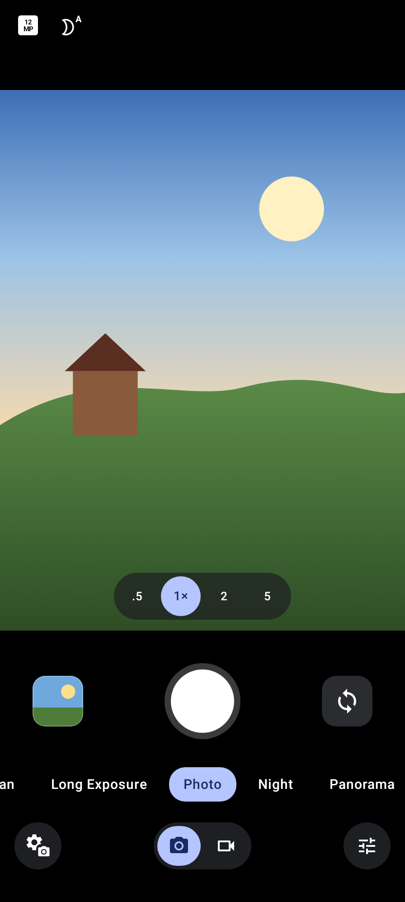
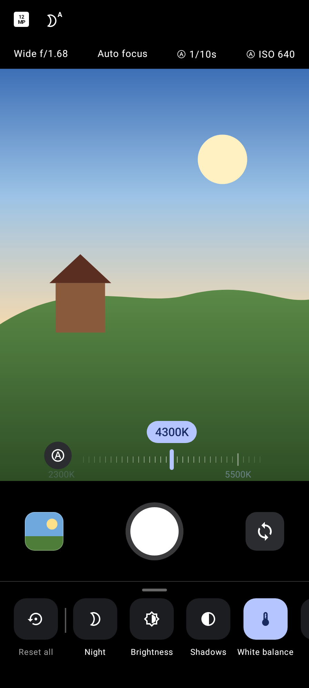
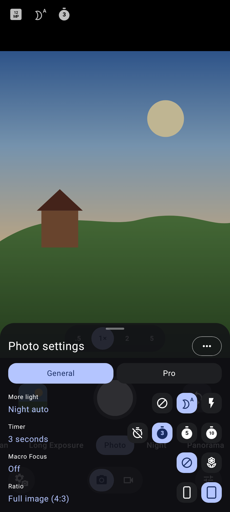
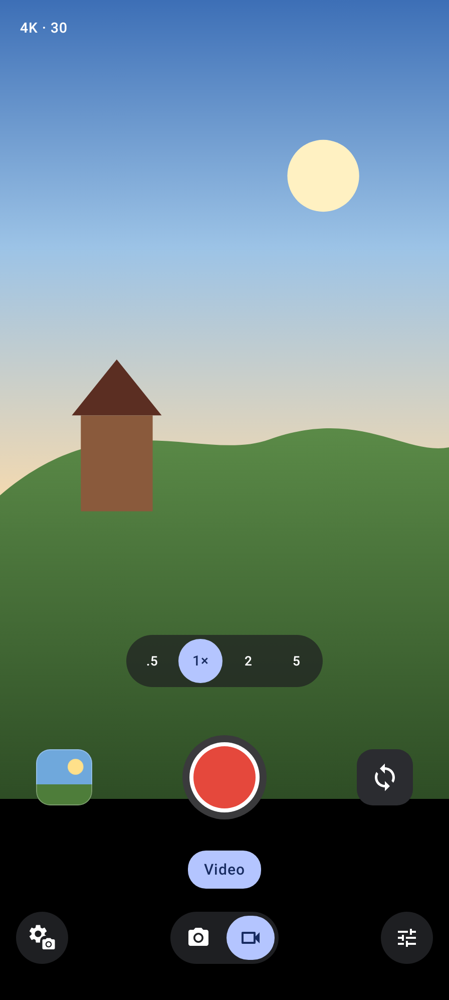
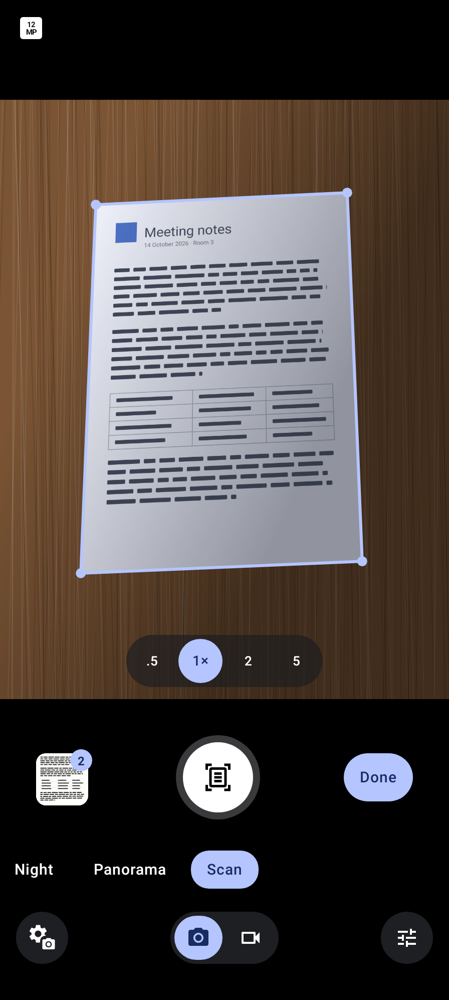
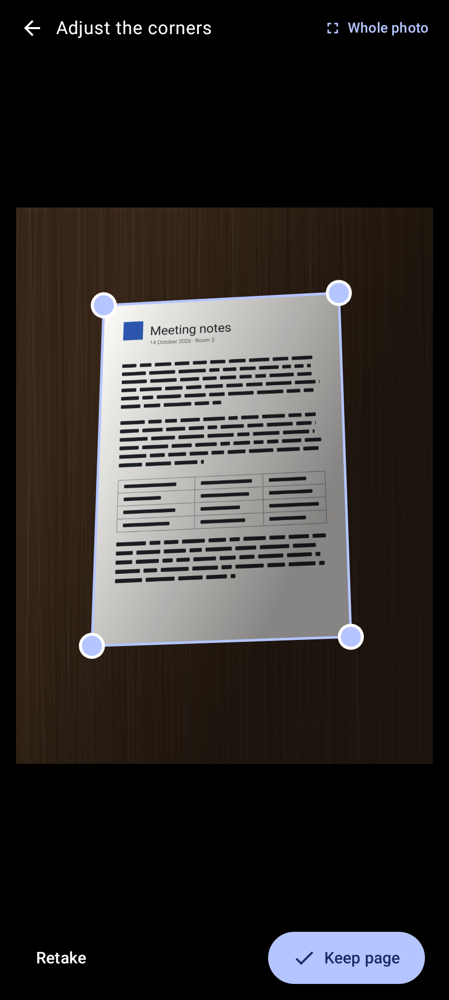
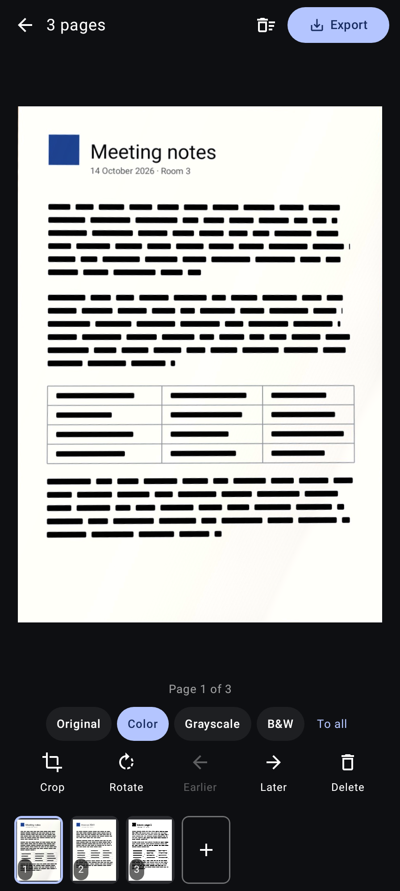
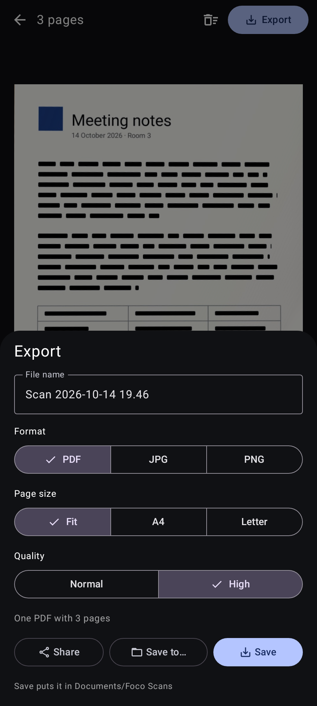

# Foco

A Google-free camera for Pixel phones, made mainly for **GrapheneOS**, laid out like Pixel Camera.

Foco has **no internet permission**, no Google Play Services, no Firebase and no tracking.
It uses Android's open-source CameraX library and the phone's own camera hardware.

<p>




</p>
<p>




</p>

## Features

- Pixel Camera-style layout: gallery bubble, shutter, flip button, zoom chips (.5 · 1× · 2 · 5) with smooth zoom, swipeable mode strip (Action Pan · Long Exposure · Photo · Night · Panorama · Scan), Photo/Video toggle, settings and Pro buttons
- **Foco processing:** every photo is merged from several frames (aligned, ghost-free) for less noise and recovered highlights, saved as **Ultra HDR** on Android 14+
- **Night:** automatic in the dark (or as a mode), multi-second handheld capture with a "hold still" guide, countdown and Off / Auto / Max slider
- **Sharper zoom:** extra frames and sharpening when zoomed past a lens
- **Long Exposure:** 3 s of frames lined up on the background and averaged, so water, traffic and crowds blur
- **Action Pan:** follow a moving subject; frames are lined up on the subject so the background streaks
- **Panorama:** turn slowly; frames are kept by gyroscope, projected onto a cylinder, lined up and blended, with a live strip and level guide
- **Scan:** live page outline, automatic edge finding with draggable corners and a magnifier, real page proportions (snaps to A4 / Letter), shadow removal; multi-page scans you can reorder, turn, re-crop and delete; Original / Color / Grayscale / Black & white per page or for all; export as **PDF** (Fit / A4 / Letter) or **JPG / PNG**, then Save (Documents/Foco Scans or Pictures/Foco Scans), Save to… any folder, or Share. Scans never go into the camera roll, and pages wait in Foco if you leave mid-scan
- **Gallery button opens Google Photos on the exact photo** (same `com.android.camera.action.REVIEW` hand-off with the MediaStore ID as Pixel Camera), otherwise Foco's own swipeable viewer of recent shots
- Photo settings sheet (General / Pro): flash, timer 3/5/10 s, macro focus, 9:16 / 4:3, 12 / 50 MP, RAW + JPEG, lens selection
- Pro controls: brightness, shadows, white balance, focus, shutter speed, ISO, with live readout; Pixel-style sliders where the scale moves under a fixed marker
- Lock-screen camera (shows only photos taken since unlocking), and works as the camera for other apps
- Tap to focus, long-press for AE/AF lock, pinch / drag zoom, double-tap 2×, volume-key shutter, grid, level with degrees and top-down crosshair, quick access controls
- Offline QR code scanning, dirty lens warning, optional location tag, option to strip phone model from photos
- Video: 1080p / 4K, Auto (24–30) / 30 / 60 fps, stabilization, 10-bit HDR, torch, pause, photo while recording; checks the microphone when you switch to Video so a blocked mic is caught before you film

Each feature is only offered when the phone actually allows it for third-party apps; otherwise it shows "Unavailable".

## Install

1. Download the latest `Foco-….apk` from [Releases](https://github.com/RealKHFan/foco/releases).
2. Open it on your phone and allow installing from that app when Android asks.
3. Updates install the same way, over the old version (settings and unfinished scans are kept).

To check the APK is really from this project, compare its signing certificate (for example with
[AppVerifier](https://github.com/soupslurpr/AppVerifier) or `apksigner verify --print-certs`). Package `io.github.realkhfan.foco`, SHA-256:

```
42:17:44:93:CE:00:D3:6E:A1:08:CB:08:35:A3:4C:9F:70:F3:0B:65:F8:63:6B:D9:33:96:5B:DA:4B:C1:2F:C1
```

## What it can't do

Pixel Camera's own processing (HDR+, Night Sight, Super Res Zoom, Magic Eraser, Best Take, etc.) is Google's software and
isn't available to other apps. Foco has its own, simpler multi-frame processing instead, so results differ. Audio zoom isn't
possible with the video recorder Foco uses. Scans aren't text-searchable (no OCR) yet.

## Build

```
./gradlew assembleDebug
```

Release signing reads `keystore.properties` (not in the repo).

## License

GPL-3.0. Written by [RealKHFan](https://github.com/RealKHFan) with help from Claude (Anthropic).
